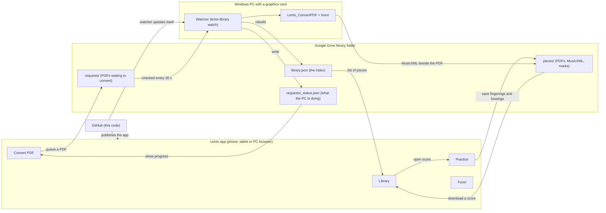

# Lento

Lento is a set of tools for practising music, starting with the cello. With it you can:

- keep all your sheet music (PDFs) in one Google Drive folder and browse it from your phone, tablet or PC,
- turn a PDF into **MusicXML** (sheet music a computer can read note by note) on your PC,
- play a score back slowly, loop a passage, and record yourself,
- get note-by-note feedback on your intonation (how in tune you are) and timing,
- tune your instrument.

The app runs in a web browser and can be installed like a normal app: https://danmosier.github.io/Lento/

New to the code? Start with **[How Lento works](docs/how-it-works.md)**. It explains every part in plain language,
with diagrams of what happens when you press each button.

## The big picture

Lento runs in three places. They never talk to each other directly: everything passes through files in one Google
Drive folder.



The PC sees the Drive folder as an ordinary folder (usually on the `G:` drive) through **Google Drive for Desktop**,
so Drive for Desktop must be running for the PC side to work. Your scores live only in your own Drive, never in this
repository.

## The parts

| Part | What it does | Runs on | Code |
| --- | --- | --- | --- |
| **Lento app** | Home screen with one module per job: Practice, Library, Convert PDF, Tuner, Settings | Any modern browser | [`app/`](app/) ([details](app/README.md)) |
| **lento-library** | Files scores into the library folder, builds `library.json`, and runs the **watcher** that converts PDFs you queue from the app | Windows PC | [`lento_library/`](lento_library/) ([details](docs/library.md)) |
| **Lento_ConvertPDF** | Turns PDFs into MusicXML using **homr** (music-reading software that needs a graphics card). Also has its own desktop window | Windows PC | [`lento_convertpdf/`](lento_convertpdf/) ([details](docs/convertpdf.md)) |
| **lento-practice** | The original practice analyzer in Python. The app's Practice module is a copy of it that runs in the browser | Any PC | [`lento_practice/`](lento_practice/) ([details](docs/practice.md)) |
| **lento_core** | Shared code: reads a MusicXML score into a list of notes | (used by the others) | [`lento_core/`](lento_core/) |

One rule holds the code together: **features never use each other's code.** Anything two features need goes into a
shared "core" (`lento_core/` for Python, `app/src/core/` for the app). That keeps each part simple and replaceable.

## Getting started

**Just using the app:** open https://danmosier.github.io/Lento/ on your phone or PC and choose *Install* (or *Add to
Home screen*). Practice and Tuner work straight away with a MusicXML file. To see your Drive library, follow
[Score library: in the app](docs/library.md#in-the-app).

**Setting up the PC** (needed only for converting PDFs and for keeping `library.json` up to date): follow the
step-by-step [PC setup guide](docs/pc-setup.md).

**Working on the code:** read [How Lento works](docs/how-it-works.md), then the README of the part you are changing.

## All the documentation

| Read this | To learn |
| --- | --- |
| [docs/how-it-works.md](docs/how-it-works.md) | How everything fits together, step by step, with diagrams and a tour of every code file |
| [docs/pc-setup.md](docs/pc-setup.md) | Installing Lento, homr and the watcher on a Windows PC, and fixing common problems |
| [docs/library.md](docs/library.md) | The Drive library folder: its layout, the `lento-library` commands, the watcher, connecting the app |
| [app/README.md](app/README.md) | The app's features and how its code is organized |
| [docs/convertpdf.md](docs/convertpdf.md) | Lento_ConvertPDF: its window, command line, PDF splitter and tests |
| [docs/convertpdf-accuracy.md](docs/convertpdf-accuracy.md) | How accurate the PDF conversion is, and its known mistakes |
| [docs/practice.md](docs/practice.md) | How the practice feedback listens and judges each note |

## Folders in this repository

```
app/                 the Lento app (TypeScript, built with Vite, published to GitHub Pages)
lento_library/       the library tools and the PC watcher (Python)
lento_convertpdf/    the PDF to MusicXML converter (Python, Windows)
lento_practice/      the Python practice analyzer
lento_core/          Python code the features share
tests/               Python tests, one folder per feature (tests/fixtures/ holds test scores)
docs/                the guides listed above
.github/workflows/   GitHub Actions: tests the app, checks its speed, and publishes it
pyproject.toml       the Python package: its dependencies and the three commands it installs
```

## Running the tests

Python (from the repository folder, after the [PC setup](docs/pc-setup.md)):

```powershell
.venv\Scripts\python.exe -m pytest -m "not homr_gpu"     # the fast tests
```

The app (needs Node.js):

```bash
cd app
npm install
npm test
```

GitHub runs the app's tests and a speed check on every pull request, and only publishes the app when both pass.

## Licence

Lento is free software: you can redistribute it and/or modify it under the terms of the GNU General Public License
as published by the Free Software Foundation, either version 3 of the License, or (at your option) any later version.
It comes with no warranty. See [LICENSE](LICENSE).
