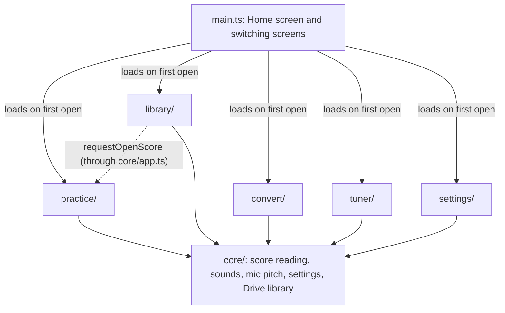

# Lento app

The Lento app for a PC, phone or tablet. Each feature is a tab.

**In plain words:** this folder is a website that installs like an app. There is no server: GitHub Pages hosts the
files, your browser downloads them once, and from then on everything (playing, recording, judging your notes) runs on
your own device. The only thing it talks to is your Google Drive, for the score library. For how the app fits with
the PC and Drive, read [How Lento works](../docs/how-it-works.md) first.

**Practice:** practise with your own sheet music. Open a MusicXML score, play it back slowly with loops and a
count-in and a metronome (whole notes down to 16ths) and a moving cursor that can allow for headphone delay, record yourself, and see every note colored by intonation and
timing, judged as strictly as you choose (pitch and timing separately: a preset, or Custom for your own windows set in
Settings, such as ±15 cents and ±80 ms).
**Transpose** moves the score up or down by up to an octave (all shown parts together, respelled for the new key),
and **Clef** shows your part in bass, tenor, alto or treble clef throughout. Both are saved for each score. They
change a copy of the MusicXML before it's read, so playback, wait mode and the check of a recording all use the
pitches you see; a clef change moves no pitch at all. Marks stay on their notes at any transposition.
**Wait mode** is for learning the notes: the cursor stops on each note (showing its name and where it's played)
and moves on only once the microphone hears it held in tune. There's no metronome. After three wrong tries it plays
the note for you. The other shown parts can follow along, and at the end you get a tally of the notes that needed
several tries.
The **speed trainer** loops the chosen measures and listens to each pass: a clean pass (80, 90 or 100% of notes in
tune and on time, without falling behind) raises the tempo a step toward the target; two passes with mistakes in a
row step it back. It remembers the fastest clean pass for each passage.
**Marks** add fingerings, bowings (down and up bow), string numbers, lifts, circles and short notes on top of the
score: pick a mark and tap notes (tap again to take it off). Marks belong to notes, not page positions, so they
stay put at any size, and they're saved on the device and, for library scores, beside the MusicXML in Drive.

**Library:** browse your score library in Google Drive, open a MusicXML into Practice or a PDF in Drive's viewer, and
queue PDFs (one or a batch) for MusicXML conversion on your PC.
Scores you've opened work offline. Setup: [docs/library.md](../docs/library.md).

**Tuner:** live note and cents from the microphone, with reference tones for the open strings.

It installs as an app (PWA), works offline, and keeps everything on the device.

```bash
npm install
npm run dev      # http://localhost:5173
npm test         # unit tests
npm run e2e      # browser (GUI) tests at phone, tablet and desktop size; npm run e2e:watch to watch them
npm run build    # static site in dist/
```

The microphone needs https (or localhost). To try it on a phone during development, run `npm run dev -- --host` and open
the https site from `npm run build` + GitHub Pages instead, or use a tunnel.

## Layout



Arrows into `core/` are imports. Features never import each other: the Library asks the core to open a score, and
Practice, which listens for that request, opens it.

The app opens on a home screen with a button per feature; the Home button in the header is always there (leaving
Practice with a score open asks first, then closes the score). Each feature is one folder with a `ui.ts` for its
screen. Features never import each other.

- `src/core/` code every feature may use: `score.ts` (MusicXML reading), `app.ts` (saved settings, one shared
  AudioContext, the open-score hand-off), `sounds.ts` (recorded instrument sounds), `player.ts` (score playback and metronome, used by Practice and the Review window), `live-pitch.ts` (microphone pitch for the tuner and wait mode), `perf.ts` (timing marks), `tolerance.ts` (your own judging windows, shared by Settings and Practice), and
  `library/` (the Google Drive library: `model.ts`, `drive.ts`, `library.ts`, `auth.ts`, and `connection.ts`, the one
  connection Library, Convert and Settings share).
- `src/practice/` Practice: `pitch.ts` (YIN pitch tracking, in a worker), `align.ts` and `analyze.ts` (ports of
  `lento_practice` in Python, which stays the reference), `report.ts`,
  `parts.ts` (the part picker), `wait.ts` (wait mode's judging), `trainer.ts` (the speed trainer's rules), `marks.ts` and `marks-view.ts` (score marks), `layout.ts` (score size for the screen), `view.ts` (transpose and clef), `focus.ts` (the Hide controls mode), `recorder.ts`, `latency.ts` (headphone delay), `ui.ts`.
- `src/library/` Library: browse and open scores. It hands a score to Practice with `requestOpenScore` from core.
- `src/convert/` Convert PDF: queue PDFs for the PC's watcher and show its status; `review.ts` is the Review window,
  and `review-play.ts` plays the score being reviewed (loaded only when Play is pressed).
- `src/tuner/` Tuner. `src/settings/` Settings (library connection, tuning, headphone delay, judging windows, sounds).
- `src/main.ts` the shell. Each feature's code loads the first time its screen opens (or, for Practice, when the
  Library sends it a score), so the app starts with about 2 KB of script however many features there are. To add a
  feature, add a folder, a home card, a view in `index.html` and a line in `LOAD` in `main.ts`.

## Instrument sounds

`public/sounds/` holds one small Opus file per instrument and loudness layer, built from VS Chamber Orchestra:
Community Edition (CC0) by `scripts/build_sounds.py` (see its header to rebuild). VSCO records about every third
semitone; the app pitch-shifts the notes between and loops a crossfaded stretch of sustained instruments. Packs
download only when an open score needs them, in the background, and stay in Cache Storage for offline use; playback
uses the synth until they arrive. Phones get one layer (about 80-460 KB per instrument), desktops two.

Playback is shaped to sound less mechanical: back-to-back notes of different pitch in a sustained part are joined
legato (the next note skips its attack and fades in under the last one's tail), every note differs very slightly in
tuning and loudness, and a short room reverb (`core/room.ts`, generated, nothing to download) is mixed in. Room
sound can be turned off in Settings.

## Speed

Responsiveness comes first: a feature that makes the app noticeably slower gets reworked or dropped.
`npm run build && npm run perf` drives the built app in Chromium with the CPU slowed 4x (about a mid-range phone)
and checks startup, bundle size, tab switching, opening scores, starting playback and checking a 3-minute recording
against `perf/budgets.json`. CI runs it on every pull request, and main only deploys when it passes.
Heavy parts load late: the score renderer loads when you press Open score, sound packs when a score needs them, and
pitch tracking runs in a Web Worker so the page keeps responding. `node perf/score.mjs <file> [part] [other parts]`
times any real score.

## Publishing

`.github/workflows/app.yml` tests and builds on every pull request that touches `app/`, and publishes `main` to
https://danmosier.github.io/Lento/ (Settings > Pages > Source: GitHub Actions).
