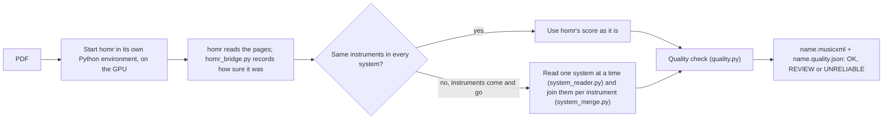

# Lento_ConvertPDF

**In plain words:** Lento_ConvertPDF reads a sheet music PDF and writes the same music as a MusicXML file, which
Practice can play and check you against. The hard part, recognising notes in a picture of a page ("optical music
recognition"), is done by **[homr](https://github.com/liebharc/homr)**, a separate open-source program that needs an
NVIDIA graphics card. Lento_ConvertPDF finds homr, runs it on each PDF, checks the result and rates it.

Most of the time you don't run it yourself: the PC watcher runs it for PDFs you queue from the app (see
[How Lento works](how-it-works.md#converting-a-pdf)). You can also use its own window for a batch, or its command line.
To install it, follow the [PC setup guide](pc-setup.md).

## How a conversion works



- There is **no fallback**. If homr can't read a PDF, it is marked failed with homr's reason and nothing is written.
- A "system" is one line of music across the page (all the staves played at the same time).
- The quality rating combines homr's own confidence with musical checks (measures that don't add up, empty measures,
  key changes that undo themselves). It catches garbled pages, not every wrong note: always check a converted score.
  Details in [convertpdf-accuracy.md](convertpdf-accuracy.md).

## Code files

| File | What it does |
| --- | --- |
| `cli.py`, `__main__.py`, `app.py` | Starting points: `python -m lento_convertpdf` opens the window; with arguments it runs on the command line |
| `gui.py` | The desktop window (Tkinter): pick PDFs, convert, view and play the result |
| `omr_engines.py` | Finds the PDFs in a folder and converts them one by one |
| `homr_runner.py` | Finds homr, checks the GPU, and runs homr as a separate program |
| `audiveris_runner.py` | Finds and runs Audiveris, the second engine (CPU, installed separately) |
| `homr_bridge.py` | Runs inside homr's environment, starts homr and records its confidence for the quality check |
| `system_reader.py`, `system_merge.py`, `instruments.py` | Reading orchestral scores one system at a time, using the instrument labels beside the staves |
| `quality.py` | Rates each converted score OK, REVIEW or UNRELIABLE |
| `musicxml_parser.py`, `audio_player.py`, `vst_catalog.py`, `models.py` | The window's MusicXML player and its instrument sounds |
| `pdf_splitter.py`, `split_tool.py`, `split_window.py`, `staff_detection.py` | The PDF splitter (one PDF with several pieces into one PDF per piece) |
| `build_exe.py` | Builds a standalone `Lento_ConvertPDF.exe` |

A standalone desktop tool to batch-transcribe sheet music PDFs into `.musicxml` files using **[homr](https://github.com/liebharc/homr)**, and preview the converted scores with an integrated **MusicXML Player** powered by the most popular open-source `.vst` / `.vst3` instrument plugins.

## Features

1. **Batch Folder Import & Per-File Selection**:
   - Imports all `.pdf` sheet music files from any chosen directory (with optional recursive subfolder scanning).
   - Interactive **`☑` / `☐` checkbox column** (plus *Select All*, *Deselect All*, *Invert Selection*, and *Select Unconverted Only* buttons) to choose which PDFs in the folder to convert.
2. **homr transcription on the GPU**:
   - Runs the real homr from its own environment, one call per PDF, with CUDA required by default.
   - No fallback: if homr cannot read a PDF, the file is marked failed with homr's reason and nothing is written.
3. **Integrated MusicXML Preview Player**:
   - Toggle between **5-Line Grand Staff Notation View** and **Multi-Instrument Color Piano-Roll View**.
   - Full transport controls: **Play ▶**, **Pause ⏸**, **Stop ⏹**, **Interactive Seek Slider**, **Tempo (BPM) override**, **Live Playhead Cursor**, and **Export to WAV**.
4. **Open-Source `.VST` / `.VST3` Instrument Sourcing & Rack**:
   - Automatically detects each instrument part in the converted MusicXML and assigns the top-recommended open-source VST plugin:
     - **Piano**: *Sfizz VST3 + Salamander Grand Piano V3* / *Dexed FM Synth VST3*
     - **Strings**: *Sfizz VST3 + Sonatina Symphonic / Virtual Playing Orchestra Strings* / *String Machine VST3*
     - **Woodwinds**: *Sfizz VST3 + Sonatina Symphonic Woodwinds*
     - **Brass**: *Sfizz VST3 + Virtual Playing Orchestra Brass* / *Odin 2 Hybrid Synth VST3*
     - **Guitar & Harp**: *Sfizz VST3 + FreePats Spanish Classical Guitar & Concert Harp*
     - **Organ & Harpsichord**: *setBfree Tonewheel & Pipe Organ VST3*
     - **Choir / Voice**: *Sfizz VST3 + Sonatina Symphonic Choir (SATB)*
     - **Percussion & Timpani**: *Geonkick Percussion & Timpani Synthesizer VST3*
     - **Universal Synth**: *Surge XT Open-Source Hybrid Synthesizer VST3*

## Setup

The step-by-step version, with every tool to install first, is the [PC setup guide](pc-setup.md). In short: Lento_ConvertPDF expects homr in a sibling folder (`..\homr`). To use another location, set `HOMR_PYTHON` or the path in the GUI.

```powershell
# homr, from the parent folder of this project (needs Git, uv and Poetry)
git clone https://github.com/liebharc/homr
cd homr
$env:POETRY_VIRTUALENVS_IN_PROJECT = 'true'
poetry env use (uv python find 3.12)
poetry install --only main --extras cuda
poetry run homr --gpu force --init      # downloads the models

# this project
cd ..\Lento
uv venv --python 3.12
uv pip install -e ".[dev]"
uv pip install winrt-runtime winrt-Windows.Foundation winrt-Windows.Foundation.Collections winrt-Windows.Globalization winrt-Windows.Graphics.Imaging winrt-Windows.Media.Ocr winrt-Windows.Storage.Streams
```

No CUDA toolkit is needed: the `cuda` extra installs the CUDA and cuDNN libraries.

## Running

```powershell
.venv\Scripts\python.exe -m lento_convertpdf                              # GUI
.venv\Scripts\Lento_ConvertPDF.exe "C:\path\to\pdfs" --output-dir "C:\out"  # command line
.venv\Scripts\python.exe -m lento_convertpdf.build_exe                    # build dist\Lento_ConvertPDF.exe
```

`--gpu force` (default) fails unless CUDA is really in use. `--gpu auto` and `--gpu no` allow the CPU.

## Audiveris, the second engine

[Audiveris](https://github.com/Audiveris/audiveris) is an older, actively maintained open-source OMR program. It runs
on the CPU, so it needs no graphics card and can work while homr has the GPU. Install it from its
[releases](https://github.com/Audiveris/audiveris/releases): on Windows the `windowsConsole` .msi is the better pick,
because it shows Audiveris's log (Java is included). Then choose **Audiveris** under *Engine* in the window, or:

```powershell
.\.venv\Scripts\Lento_ConvertPDF.exe "C:\path\to\pdfs" --engine audiveris               # finds it in Program Files
.\.venv\Scripts\Lento_ConvertPDF.exe "C:\path\to\pdfs" --engine audiveris --audiveris "D:\Apps\Audiveris\Audiveris.exe"
```

Its exports get the same OK / REVIEW / UNRELIABLE rating, but only from the musical consistency checks: Audiveris
reports no per-note confidence. Where it splits a PDF into movements, the first movement is kept and the export is
flagged. The PC watcher still uses homr.

## Comparing engines (and homr on GPU vs CPU)

```powershell
.\.venv\Scripts\python.exe tests\convertpdf\compare_engines.py --keep out\engines
.\.venv\Scripts\python.exe tests\convertpdf\compare_engines.py --scores "G:\My Drive\Sheet Music\Cello\pieces" --limit 20 --keep out\engines
```

Runs every PDF that has a reference MusicXML beside it (the test fixtures by default, or any folder, such as
MuseScore files the library exported to both PDF and MusicXML) through homr on the GPU, homr on the CPU and
Audiveris, and writes `engine-comparison.md` and `.csv`: pitch and strict F1 against the reference, time taken, and
how closely homr's CPU reading matches its GPU reading. `--variants homr-gpu audiveris` runs only some.
Page images (.png, .jpg, …) work as well as PDFs. For the free [sheet-music-photos](https://github.com/liebharc/sheet-music-photos)
dataset, point `--scores` at its `scans` folder: each hand-checked page (`page.pdf` + `page.musicxml`) and each photo
of it is scored; pages with only homr's own reading (`reference.musicxml`) are left out because they favour homr.

Measured 2026-11-25 on the fixtures: homr is as accurate on the CPU as on the GPU (97.4% pitch and 92.9% strict
F1 on average for both; the two readings agree 99.6%), but takes about 1.8 times as long.

## Splitting a PDF of several pieces

A quick tool of its own (no homr or GPU needed). It proposes the pieces beside a preview of the pages; nothing is
written until you press Split, and the original is never changed. Check the proposals: scans are often cut wrongly.

```powershell
.venv\Scripts\python.exe -m lento_convertpdf.split_tool "C:\path\to\album.pdf"  # or no file, to browse for one
.venv\Scripts\python.exe -m lento_convertpdf.split_tool --install                 # right-click > Send to, and a desktop icon to drop PDFs on
```

The pieces go to a new folder beside the PDF, or to `inbox/` for a PDF in a Lento library's `pieces/`.

## Tests

```powershell
.venv\Scripts\python.exe -m pytest -m "not homr_gpu"                 # fast
.venv\Scripts\python.exe -m pytest -m homr_gpu -s -W ignore          # real homr, prints accuracy
.venv\Scripts\python.exe tests\convertpdf\compare_musicxml.py reference.mxl output.musicxml
```

Any `name.pdf` with a matching `name.mxl` or `name.musicxml` under `tests/fixtures` becomes an accuracy test.
Export flags, measured accuracy and orchestral limits are described in [convertpdf-accuracy.md](convertpdf-accuracy.md).
Minimum scores go in `tests/fixtures/baselines.json`, for example `{"name": {"pitch_f1": 0.9, "strict_f1": 0.85}}`.
Scores without a baseline are measured and printed, then skipped.
