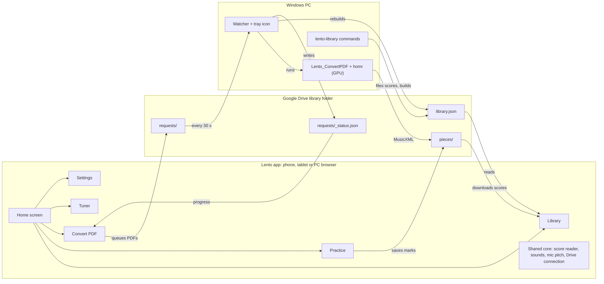
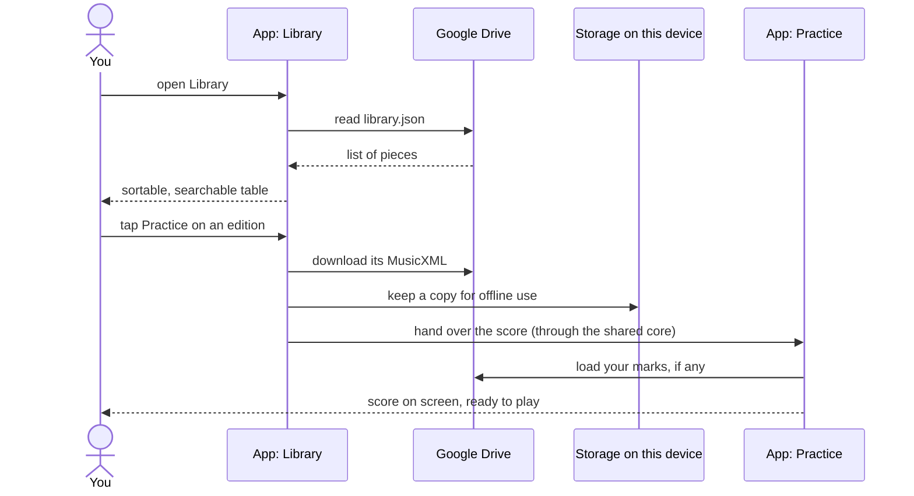
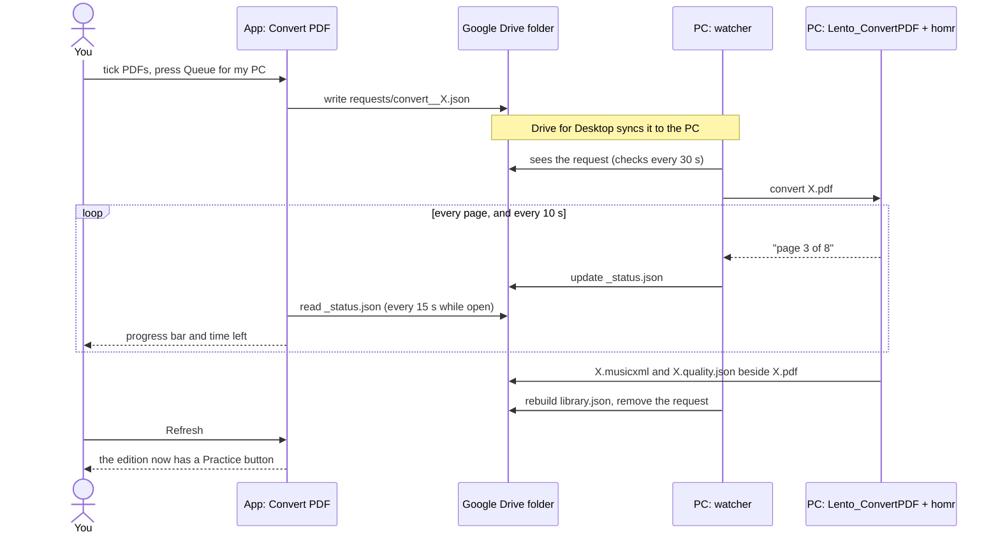
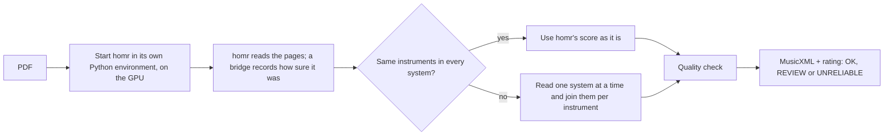
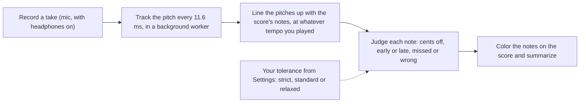
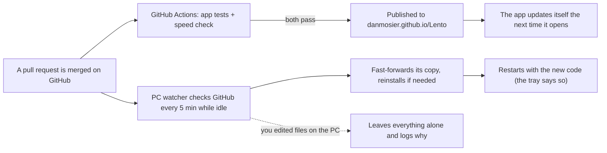

# How Lento works

This guide explains Lento for someone who has never worked on it, or on any code. It goes from the big picture down
to individual files. You don't need to read it all at once: each section stands on its own.

- [Words you'll see](#words-youll-see)
- [The three places Lento runs](#the-three-places-lento-runs)
- [The files in the Drive folder](#the-files-in-the-drive-folder)
- [Opening a score to practise](#opening-a-score-to-practise)
- [Converting a PDF](#converting-a-pdf)
- [Practice feedback: listening and comparing](#practice-feedback-listening-and-comparing)
- [How updates arrive](#how-updates-arrive)
- [A tour of the code](#a-tour-of-the-code)
- [Rules the code follows](#rules-the-code-follows)

## Words you'll see

| Word | Meaning |
| --- | --- |
| **MusicXML** | A file format for sheet music that a computer can read note by note (`.musicxml`, or zipped as `.mxl`). A PDF is only a picture of the page; MusicXML is what lets Lento play a score and check you against it. |
| **OMR** | Optical music recognition: reading the notes from a picture of a page, like text recognition but for music. |
| **homr** | The open-source OMR program Lento uses. It runs on an NVIDIA graphics card (the **GPU**). |
| **PWA** | Progressive web app: a website that can be installed like an app and works offline. The Lento app is one. |
| **Module** | One feature of the app with its own screen: Practice, Library, Convert PDF, Tuner, Settings. |
| **library.json** | The index of your score library: every piece, its PDFs, and which have MusicXML. The app reads it to show the Library. |
| **Watcher** | A program that runs in the background on the PC, converts the PDFs you queue from the app, and keeps `library.json` up to date. |
| **Google Drive for Desktop** | Google's PC app that shows your Drive as a normal folder (usually the `G:` drive) and keeps it in sync. |
| **Cents** | A hundredth of a semitone. Being 10 cents sharp is a small but audible error. |
| **Pull request (PR)** | A proposed change to the code on GitHub. When it's *merged*, it becomes part of the main code. |

## The three places Lento runs

1. **The app** runs entirely in your browser. There is no Lento server: the app is a set of files published on GitHub
   Pages, and everything it does (playing, recording, judging your notes) happens on your own device. It talks to
   Google Drive directly, after you sign in with Google.
2. **The Google Drive folder** holds your scores and a few small files that let the app and the PC leave messages
   for each other. It is the only connection between them.
3. **The PC** does the heavy work: converting PDFs with homr on the graphics card. It sees the Drive folder through
   Google Drive for Desktop, so Drive for Desktop has to be running.

Because they only share files, the phone never needs to reach the PC. If the PC is off, a queued PDF simply waits
in Drive until it is on again.

## The files in the Drive folder

Who writes each file, and who reads it:

| File | Written by | Read by | What it holds |
| --- | --- | --- | --- |
| `library.json` | PC (`lento-library build`, or the watcher) | App: Library and Convert PDF | Every piece, its PDFs and MusicXML, its catalog details |
| `catalog.csv` | You (in Excel or Sheets), `lento-library add` and `details` | PC, when building `library.json` | Composer, title, year, genre, level and technique tags for each PDF |
| `pieces/<piece>/<piece>__<edition>.pdf` | You | App (opens it in Drive's viewer) | The sheet music |
| `pieces/.../<same name>.musicxml` | PC (the converter, or MuseScore export) | App: Practice | The notes, for playback and feedback |
| `pieces/.../<same name>.quality.json` | PC (the converter) | PC, when building `library.json` | How trustworthy the conversion is: OK, REVIEW or UNRELIABLE |
| `pieces/.../<same name>.marks.json` | App: Practice | App: Practice | Your fingerings, bowings, string numbers and notes |
| `requests/convert__<pdf name>.json` | App: Convert PDF and Library | PC: the watcher | "Please convert this PDF" |
| `requests/failed__<pdf name>.json` | PC: the watcher | App: Convert PDF | A conversion that failed, with homr's reason |
| `requests/_status.json` | PC: the watcher | App: Convert PDF | What the PC is doing now, its queue, a heartbeat and recent results |
| `inbox/` | You | You, with `lento-library add` | New downloads waiting to be filed |

The naming rule matters: **a MusicXML file sits beside its PDF with the same name.** That pairing is how Lento knows
which PDFs already have MusicXML. The full layout is in [library.md](library.md#layout).

## Opening a score to practise

Everything here happens on the phone.

- If an edition has no MusicXML yet, the Library shows **Make MusicXML**, which starts the conversion below.
- Instrument sounds (recorded samples) download in the background only when an open score needs them. Until they
  arrive, playback uses a simple synthesizer.
- Practice can play the score slowly, loop measures, count in, click a metronome, follow along with a cursor (which
  can allow for Bluetooth headphone delay), and fit the score to a phone screen.

Code: `app/src/library/ui.ts`, `app/src/core/library/`, `app/src/core/app.ts` (the hand-over), `app/src/practice/ui.ts`.

## Converting a PDF

This is the one flow that uses all three places.

- If homr can't read the PDF, the watcher renames the request to `failed__X.json` with homr's reason, so it isn't
  retried forever. The app shows "last try failed" and the reason. Queueing it again tries once more.
- The app knows the PC is on because the watcher renews a **heartbeat** (a time stamp) in `_status.json`. A stale
  heartbeat means the PC is off or asleep.
- **Remove from queue** in the app moves the request file to Drive's bin; the watcher then skips that PDF.
- The tray icon by the PC's clock shows the same thing: teal when waiting, amber while converting.

### Inside the converter

A "system" is one line of music across the page. Solo parts are read in one go; orchestral scores where instruments
come and go are read system by system. There is no fallback: a score comes from homr or the PDF fails. The rating
catches garbled pages but not every wrong note, so the Library shows a **check** badge on converted scores. One known
homr mistake for cello: reading tenor clef as alto, which moves every note by a third. More in
[convertpdf.md](convertpdf.md) and [convertpdf-accuracy.md](convertpdf-accuracy.md).

### MuseScore files

A MuseScore file (`.mscz`) placed in a piece folder is exported by the watcher, using MuseScore itself, to an exact
MusicXML and PDF beside it. The app shows those with a green **MuseScore** badge instead of "check".

## Practice feedback: listening and comparing

Practice listens in two different ways.

**After a take**, it studies the whole recording carefully:

1. **Pitch tracking** uses an algorithm called YIN, which finds the pitch to about a cent. It runs in a *Web Worker*
   (a background thread) so the screen stays responsive. Code: `practice/pitch.ts`, `pitch.worker.ts`.
2. **Alignment** works out which part of your recording belongs to which note, even if you played slower, sped up,
   or started in the middle. It uses *dynamic programming*: trying every way to match the recording to the notes in
   order and keeping the best. Code: `practice/align.ts`.
3. **Judging** takes each note's steady middle (skipping the bow attack and averaging out vibrato) and compares it to
   the written pitch. Timing is measured against your own local tempo, so a gradual slow-down is reported once rather
   than against every note. Several notes in a row off by the same interval are marked "score may be wrong", because
   that usually means homr misread the clef. Code: `practice/analyze.ts`.
4. **Results**: green in tune, amber slightly off, red out of tune or wrong note, purple missed, blue "score may be
   wrong". Code: `practice/report.ts`.

The **speed trainer** repeats this for every pass of a looped passage: a clean pass raises the tempo a step, two
passes with mistakes in a row lower it (`practice/trainer.ts`).

**While you play**, a quicker live pitch reading (`core/live-pitch.ts`) drives:

- **Wait mode**: the cursor stops on each note and only moves on when it hears that note held in tune
  (`practice/wait.ts`).
- **The Tuner**: the note name and how many cents sharp or flat (`tuner/`).

The browser version mirrors the Python analyzer in `lento_practice/`, which stays the reference: when the two
disagree, the Python version is treated as correct. Details: [practice.md](practice.md).

## How updates arrive

The speed check drives the built app in a browser slowed down to about a mid-range phone, and fails if starting the
app, opening a score or checking a recording takes longer than `app/perf/budgets.json` allows. Responsiveness is a
top priority: a change that makes the app noticeably slower gets reworked.

## A tour of the code

### The app (`app/`)

Written in TypeScript (JavaScript with types), built with Vite, tested with Vitest.

| File or folder | What it does |
| --- | --- |
| `index.html` | Every screen of the app, each in its own hidden section |
| `src/main.ts` | The shell: Home screen, switching screens, loading each module the first time it opens |
| `src/style.css` | How everything looks, in light and dark |
| `src/core/app.ts` | Saved settings, the one shared audio connection, and the hand-over of a score from Library to Practice |
| `src/core/score.ts` | Reads a MusicXML file into a list of notes with times (mirrors `lento_core/score.py`) |
| `src/core/sounds.ts`, `room.ts` | Recorded instrument sounds and a little room echo for playback |
| `src/core/live-pitch.ts` | Live microphone pitch, for the tuner and wait mode |
| `src/core/perf.ts` | Timing marks the speed check reads |
| `src/core/library/` | The Google Drive connection: sign-in (`auth.ts`), Drive calls (`drive.ts`), reading the library and offline copies (`library.ts`), the shape of `library.json` (`model.ts`), the saved folder link (`connection.ts`) |
| `src/practice/` | Practice: screen (`ui.ts`), playback and metronome (`player.ts`), recording (`recorder.ts`), pitch tracking (`pitch*.ts`), alignment and judging (`align.ts`, `analyze.ts`, `report.ts`), part picker (`parts.ts`), wait mode (`wait.ts`), speed trainer (`trainer.ts`), marks (`marks.ts`, `marks-view.ts`), headphone delay (`latency.ts`), phone layout (`layout.ts`, `focus.ts`) |
| `src/library/` | Library: the screen (`ui.ts`) and the fast scrolling table (`table.ts`) |
| `src/convert/` | Convert PDF: the screen (`ui.ts`) and working out the queue from `_status.json` (`queue.ts`) |
| `src/tuner/`, `src/settings/` | Tuner and Settings |
| `public/sounds/` | The instrument sound files (built by `scripts/build_sounds.py`) |
| `test/` | Automated tests, including synthetic cello recordings to check the feedback |
| `perf/` | The speed check and its budgets |

More: [app/README.md](../app/README.md).

### The PC side (`lento_library/`)

| File | What it does |
| --- | --- |
| `cli.py` | The `lento-library` command and its subcommands: `build`, `check`, `add`, `convert`, `watch`, `organize`, `details` |
| `library.py` | The library on disk: finding pieces, pairing PDFs with MusicXML, writing `library.json`, request files |
| `watch.py` | The watcher's loop, `_status.json`, and installing it to start at sign-in |
| `tray.py` | The tray icon and its notifications |
| `update.py` | Updating itself from GitHub |
| `organize.py` | Filing an unorganized folder into the library layout, in batches you approve, with undo |
| `metadata.py` | Filling `catalog.csv` details from a spreadsheet |
| `musescore.py` | Exporting MuseScore files with MuseScore |

### The converter (`lento_convertpdf/`)

See the file table in [convertpdf.md](convertpdf.md#code-files).

### The Python analyzer (`lento_practice/`) and shared code (`lento_core/`)

| File | What it does |
| --- | --- |
| `lento_core/score.py` | Reads a MusicXML part into notes with beats and seconds |
| `lento_practice/audio.py` | Loads a recording and tracks its pitch |
| `lento_practice/align.py` | Lines the pitch track up with the notes |
| `lento_practice/analyze.py` | Judges each note |
| `lento_practice/report.py` | Writes the summary, a table, JSON, and a colored copy of the score |
| `lento_practice/cli.py` | The `lento-practice` command |

### Tests (`tests/`)

One folder per Python feature (`tests/convertpdf/`, `tests/practice/`, `tests/library/`). Run the fast ones with
`.venv\Scripts\python.exe -m pytest -m "not homr_gpu"`. Tests marked `homr_gpu` run the real homr and are slow.

## Rules the code follows

- **Features never use each other's code.** Practice doesn't import Library, Library doesn't import Practice, and so
  on. Shared code goes in a core (`app/src/core/`, `lento_core/`). When one feature needs to hand something to
  another, like the Library opening a score in Practice, it goes through the core.
- **The app must stay fast.** Each module's code loads only when its screen first opens, heavy work runs in the
  background, and GitHub refuses to publish a version that is slower than the budgets.
- **Your scores stay private.** They live in your Google Drive. The repository holds only code, and the app can only
  change files it made itself (request files and marks).
- **Nothing is changed without asking.** Filing a folder (`organize`) only moves files batch by batch after you
  approve, and can be undone. The watcher's self-update never overwrites local edits.
