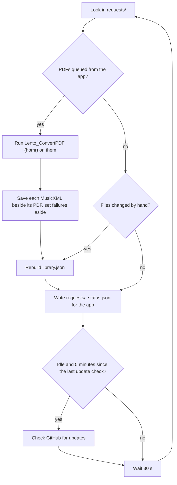

# Setting up the PC

The PC does two jobs the phone can't: it converts PDFs to MusicXML with homr (which needs an NVIDIA graphics card),
and it keeps the library's index, `library.json`, up to date. Both are done by the **watcher**, a small program that
starts when you sign in to Windows and runs quietly in the background, with an icon in the system tray.

You set this up once. After that, updates arrive by themselves (see [Updating](#updating)).

This guide assumes no programming experience. Every command goes into **PowerShell** (press Start, type
`PowerShell`, open it). Copy one block at a time and press Enter.

## What you need

| Thing | Why | Where to get it |
| --- | --- | --- |
| Windows 10 or 11 with an **NVIDIA graphics card** | homr reads music on the graphics card (GPU) | |
| **Google Drive for Desktop** | Shows your Drive library folder as a normal folder (usually `G:\My Drive\...`), so the PC can read and write it | https://www.google.com/drive/download/ |
| **Git** | Downloads Lento's code, and lets the watcher update itself | https://git-scm.com/download/win |
| **uv** | Installs Python and Lento's Python packages | https://docs.astral.sh/uv/ (or run `winget install astral-sh.uv`) |
| **Poetry** | Installs homr's own packages | `uv tool install poetry` |
| MuseScore 4 (optional) | Only if you keep MuseScore files (`.mscz`) in the library | https://musescore.org/ |

After installing Git and uv, close PowerShell and open it again, so it finds them.

## Words used in this guide

- **Repository (repo):** the folder of Lento's code, copied from GitHub with `git clone`.
- **Virtual environment (venv):** a private copy of Python inside the repo folder (`.venv\`), holding exactly the
  packages Lento needs, so nothing else on the PC is affected. Lento's venv is made with `uv`, so it has no `pip.exe`:
  install packages with `uv pip install`, not `pip install`.
- **Library folder:** your score folder in Google Drive, as the PC sees it, for example
  `G:\My Drive\Lento Library`. Its layout is described in [library.md](library.md).

## 1. Download Lento and homr

Pick a folder for code. This guide uses `C:\Code`; any folder works, as long as Lento and homr sit side by side in it.

```powershell
mkdir C:\Code -Force
cd C:\Code
git clone https://github.com/DanMosier/Lento.git
git clone https://github.com/liebharc/homr.git
```

You now have `C:\Code\Lento` and `C:\Code\homr`.

## 2. Install homr (once, about 10 minutes)

homr gets its own environment because it needs different packages from Lento.

```powershell
cd C:\Code\homr
$env:POETRY_VIRTUALENVS_IN_PROJECT = 'true'
poetry env use (uv python find 3.12)
poetry install --only main --extras cuda
poetry run homr --gpu force --init
```

The last line downloads homr's models and checks that the graphics card works. No separate CUDA install is needed;
the `cuda` extra brings it.

## 3. Install Lento

```powershell
cd C:\Code\Lento
uv venv --python 3.12
uv pip install -e ".[dev]"
uv pip install winrt-runtime winrt-Windows.Foundation winrt-Windows.Foundation.Collections winrt-Windows.Globalization winrt-Windows.Graphics.Imaging winrt-Windows.Media.Ocr winrt-Windows.Storage.Streams
```

- `uv venv` makes the virtual environment in `.venv\`.
- `-e ".[dev]"` installs Lento from this folder in "editable" mode: when the code changes (for example after an
  update), the installed commands use the new code straight away.
- The `winrt` packages give the converter Windows' own text recognition, used to read instrument names on a score.

Check that it worked:

```powershell
.venv\Scripts\lento-library.exe --help
```

It should print the list of `lento-library` commands. (If homr is not beside Lento, set the `HOMR_PYTHON`
environment variable to homr's Python, or choose it in Lento_ConvertPDF's window.)

## 4. Point Lento at your library folder

Make sure Google Drive for Desktop is running and you can open your library folder in File Explorer. Then build the
first index (replace the path with your own library folder):

```powershell
cd "G:\My Drive\Lento Library"
C:\Code\Lento\.venv\Scripts\lento-library.exe build
```

`build` reads the folders and `catalog.csv` and writes `library.json`, the list of pieces the app shows. If your
folder isn't in the library layout yet, see [Filing an existing folder](library.md#filing-an-existing-folder) first.

## 5. Start the watcher

Still in the library folder:

```powershell
C:\Code\Lento\.venv\Scripts\lento-library.exe watch --install
```

This adds a small file to your Windows Startup folder, so the watcher starts hidden every time you sign in. To start
it now without signing out:

```powershell
Start-Process wscript.exe "`"$env:APPDATA\Microsoft\Windows\Start Menu\Programs\Startup\Lento library watcher.vbs`""
```
 You should see a round icon with a note by the clock (Windows may hide it
under the **^** arrow):

| Icon | Meaning |
| --- | --- |
| Teal | Waiting for work |
| Amber | Converting (hover to see the piece, the page and the time left) |
| Grey | Waiting for Google Drive to start |

Right-click it to open the library folder, the log, or the app, or to quit the watcher.

What the watcher does, every 30 seconds:



## 6. Connect the app

On each phone, tablet or PC browser, open the app, go to **Settings > Google Drive library**, paste the Drive link
of the library folder and press **Connect to Google Drive**. Details: [library.md, In the app](library.md#in-the-app).

To test the whole chain, open **Convert PDF** in the app, queue one PDF, and watch the tray icon turn amber.

## Updating

The installed watcher updates itself. Every five minutes while it is idle it asks GitHub whether anything new has been
merged. If so, it fast-forwards the repo to the new code (never merging or overwriting anything), reinstalls if the package list in `pyproject.toml`
changed, and restarts; the tray icon says so. It never overwrites your own changes: if you have edited files in the
repo folder, it leaves everything alone and writes the reason in the log.

To update by hand instead:

```powershell
cd C:\Code\Lento
git pull --ff-only
uv pip install -e ".[dev]"
```

then quit the watcher from its tray menu and start it again (step 5).

## When something goes wrong

The watcher's log is `requests\_watch.log` in the library folder (or right-click the tray icon > open log). It says
what it did and why something failed.

| Problem | What to do |
| --- | --- |
| Tray icon stays grey | Google Drive for Desktop isn't running or the library folder isn't there. Start Drive; the watcher continues by itself. |
| No tray icon at all | The watcher isn't running. Run step 5 again, including the line that starts it now. |
| The app says the PC is offline | The PC is off, asleep, or the watcher stopped. The app decides from the heartbeat in `_status.json`, renewed on every look and every 10 seconds during a conversion. |
| A PDF shows "last try failed" | homr couldn't read it. The reason is in the app, the log and `requests\failed__<name>.json`. Queue it again to retry once. |
| `homr` says CUDA or the GPU is missing | Update the NVIDIA driver, then run `poetry run homr --gpu force --init` in the homr folder again. |
| The log says an update was skipped | The repo folder has local changes. Run `git status` in it; undo or commit them. |
| `pip` is not recognised | Use `uv pip install ...` (the venv has no pip). |
| After moving the repo folder, nothing starts | A venv can't be moved. Delete `.venv`, repeat step 3, then step 5. |

More on the watcher (MuseScore files, page progress, removing items from the queue): [library.md](library.md).
